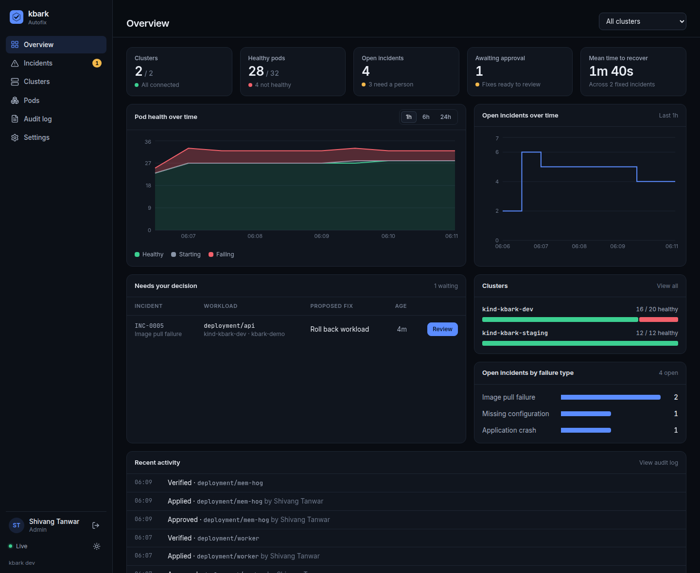
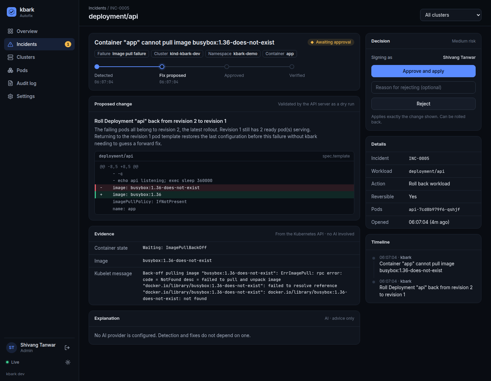

# kbark

**Kubernetes pod failures, detected and fixed — with a person approving every change.**

kbark has two modes in one binary:

- **`kbark serve`** watches every pod in one or more clusters, opens an
  incident when one fails, proposes a specific fix as a diff, and applies
  it only after a named person approves it on the dashboard. Then it
  checks that the failure actually cleared.
- **`kbark`** is a terminal UI in the spirit of k9s. Press **`?`** on any
  pod, deployment, log line, or event for an inline AI diagnosis. This
  mode is read-only.





## Autofix dashboard

```sh
kbark serve --contexts kind-kbark-dev,kind-kbark-staging
# kbark autofix dashboard: http://127.0.0.1:8765
```

What happens when a pod fails:

1. **Detect.** Detectors written in Go read pod status and events. No AI
   is involved in deciding what is wrong.
2. **Propose.** A fixed playbook picks one of nine typed fixes, or says
   that no safe automatic fix exists and why.
3. **Approve.** The dashboard shows the evidence, an optional AI
   explanation, and the change as a diff validated by the API server as
   a dry run. Nothing is written until a signed-in approver approves it.
4. **Apply and verify.** kbark applies exactly the approved change, waits
   for the rollout, and confirms the failure stays clear. If it does not,
   the incident is marked failed and the change can be rolled back.
5. **Record.** Every step goes to an append-only audit log.

| Failure | Fix kbark can apply |
|---|---|
| Out-of-memory kills | Raise the memory limit (doubling, up to a ceiling) |
| Crash, bad image or missing config on the latest rollout | Roll the Deployment, StatefulSet or DaemonSet back one revision |
| One pod failing while its siblings on the same revision are healthy | Replace that pod |
| Liveness probe killing a slow starter | Relax probe timing |
| Evicted pods left behind | Delete the dead pod records |
| Pods pending on a cordoned node | Uncordon the node |
| Readiness check slower than its deadline | Raise the readiness timeout |
| Evicted for exceeding the local disk limit | Raise the ephemeral-storage limit |
| Image absent from the node with pull policy `Never` | Change the policy to `IfNotPresent` |
| Service selector that nearly matches its pods | Correct the selector |
| Pods refused at creation on the latest rollout (missing ServiceAccount, Pod Security, LimitRange) | Roll back |
| Storage, quota, credentials, application bugs | None: explained and left to a person |

Around that loop:

- **Sign-in and roles.** `--auth-file` enables accounts (viewer, approver,
  admin); approvals are recorded against the signed-in account. Without
  it the console listens on localhost only. An optional `oidc` block in
  the users file adds single sign-on (OpenID Connect with PKCE; role by
  email or domain), and `--session-file` (default next to the state file)
  keeps sessions across a restart.
- **Policy.** `--policy` sets, per cluster and namespace, which fixes may
  be proposed, a memory ceiling, and detect-only areas. No policy can
  remove the approval step.
- **History.** Incidents and health trends are saved and survive restarts.
- **Metrics.** `--metrics-addr` (e.g. `127.0.0.1:9108`) serves Prometheus
  metrics on a separate loopback listener.
- **Demo lab.** `--demo` adds a console page that injects sample failures
  into the `kbark-demo` namespace with one click, so a demonstration needs
  no terminal. Off by default; admin role only; `--demo-kubeconfig` gives
  it credentials separate from the ones kbark fixes with.
- **Notifications.** `--notify-webhook` posts to a Slack-compatible
  webhook when a fix is waiting, fails, or is verified.

The same incidents are available in the terminal with `kbark incidents`,
`kbark incidents show <id>` and `kbark incidents approve <id> --as <name>`.

The console is a React and TypeScript app in [`web/`](web/), compiled into
the binary (`task ui` rebuilds it). To put it on a server behind nginx
with TLS, see [deploy/server/](deploy/server/); read
[SECURITY.md](SECURITY.md) first.

Design and deployment: [docs/AUTOFIX_PLAN.md](docs/AUTOFIX_PLAN.md).
Failure families and fixes: [docs/FAILURE_PLAYBOOK.md](docs/FAILURE_PLAYBOOK.md).
Try it on two local Kind clusters with `demo/demo.sh up`.

## Terminal UI


## Install

```sh
# Homebrew (macOS, Linux)
brew install shivangtanwar/tap/kbark

# Scoop (Windows)
scoop bucket add kbark https://github.com/shivangtanwar/scoop-bucket
scoop install kbark

# Go (any platform)
go install github.com/shivangtanwar/kbark/cmd/kbark@latest
```

Pre-built archives (Linux / macOS / Windows, amd64 + arm64) and a
cosign-signed `SHA256SUMS` are published with every release on the
[Releases page](https://github.com/shivangtanwar/kbark/releases).

## Quick start

```sh
export ANTHROPIC_API_KEY=sk-ant-...   # or OPENAI_API_KEY, or run Ollama
kbark                                  # uses your current kubeconfig context
```

Arrow to any resource and press **`?`** to ask kbark what's wrong with
it. Press `q` (or `Ctrl-C`) to quit.

Sanity-check your setup any time with `kbark doctor`.

## Configuration

kbark reads `~/.config/kbark/config.yaml` (or the platform equivalent).
A config file is optional — the built-in default profile points at
Anthropic with `claude-sonnet-4-6` and saves transcripts under
`~/.cache/kbark/diagnoses/`.

```yaml
default_profile: dev

profiles:
  dev:
    provider: anthropic
    model: claude-sonnet-4-6
    transcripts: on
    token_budget: 0          # 0 = unbounded; set a cap to fail-fast on huge payloads

  cheap:
    provider: openai
    model: gpt-4o-mini

  offline:
    provider: ollama
    model: llama3.2

  gateway:                   # any OpenAI-compatible endpoint (LiteLLM, a proxy)
    provider: openai
    base_url: http://127.0.0.1:4000/v1
    api_key_env: MY_GATEWAY_KEY   # name of the env var holding the key
    model: claude-sonnet-4-6
```

Switch profiles at startup with `kbark --profile cheap`, mid-session
with `:profile cheap`, or via the `KBARK_PROFILE` env var.

## What the terminal UI does

- **Live resource tables** for pods, deployments, statefulsets,
  daemonsets, services, jobs, cronjobs, nodes, events, configmaps,
  secrets, and ingresses — uniform keymap, real-time updates.
- **Read-only describe + YAML modal** on `Enter` (managed-fields
  stripped so you can actually read the YAML).
- **AI diagnosis on `?`** that pulls describe + events + recent logs,
  redacts secrets and obvious credentials before any byte leaves the
  process, and streams a plain-English explanation inline.
- **Tool-using diagnosis sessions** — the model can ask for more
  logs, more events, or the previous container's output without you
  reaching for `kubectl`.
- **Per-diagnosis transcripts** saved as Markdown under
  `~/.cache/kbark/diagnoses/` so you can grep for "the time I saw
  CrashLoopBackOff on the canary" months later.
- **Three providers**: Anthropic, OpenAI, Ollama. Models swap with a
  one-line config edit.

## What kbark deliberately doesn't do

- **No writes without approval.** The terminal UI is read-only. The
  autofix layer can make nine kinds of change and makes none of them
  until a named person approves that specific change.
- **No free-form remediation.** kbark never runs a shell command, execs
  into a container, or executes anything a language model wrote.
- **No background telemetry.** Your kubeconfig, API key, and cluster
  state stay on your machine, except for the redacted payloads sent to
  your chosen AI provider: on the `?` key, and once per incident for
  the dashboard's explanation (turn that off with `--no-ai`).

## Security

- kbark writes to a cluster only through nine typed actions in
  `internal/remediate`, each after a named approval. `deploy/rbac.yaml`
  is the full permission set.
- Every payload bound for an AI provider passes through `internal/redact`
  first — credentials, tokens, passwords, and JWT-shaped values are
  replaced with `<redacted>` before the network call.
- Releases ship a cosign-signed `SHA256SUMS`; verify with the recipe in
  [docs/RELEASING.md](docs/RELEASING.md).
- Report a vulnerability via the
  [security advisory form](https://github.com/shivangtanwar/kbark/security/advisories/new)
  — not a public issue. See [SECURITY.md](SECURITY.md).

## Status

kbark is in active development. v0.1 shipped the terminal UI and the
`?` key; the autofix layer is on `main` and has been exercised on Kind
clusters only. Bug reports and feature proposals
welcome — see [CONTRIBUTING.md](CONTRIBUTING.md) and the issue
templates.

## License

[Apache-2.0](LICENSE).
